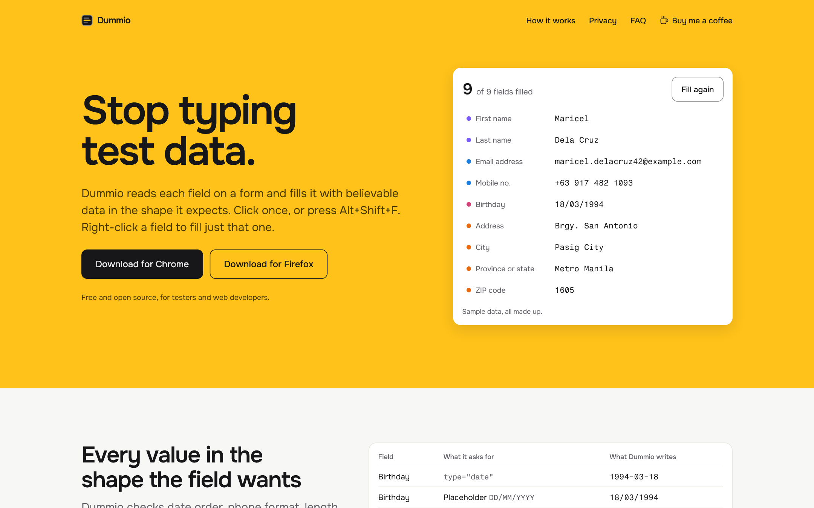

<p align="center">
  <a href="https://dummio.vercel.app/"></a>
</p>

<h1 align="center">Dummio site</h1>

<p align="center">
  <b>The landing page for <a href="https://github.com/melvinbulan17/dummio">Dummio</a>.</b><br>
  Shows what the extension does with a live fill demo, and gets people to the download.
</p>

<p align="center">
  <a href="https://dummio.vercel.app/"></a>
  <a href="LICENSE"></a>
  
</p>

<p align="center">
  <a href="https://dummio.vercel.app/"></a>
</p>

## What's here

- A home page with a live fill demo, which is still complete without JavaScript.
- A privacy policy page, plus a sitemap and search metadata.
- Google Analytics, which only loads after a visitor chooses Allow.

The site is separate from the extension, so changes here can't touch extension builds. Every merge to `main` deploys to Vercel.

## Development

Requires Node 26 and pnpm 12.

```bash
pnpm install
cp .env.example .env.local
pnpm dev
```

The site runs at http://localhost:3000. Run the tests with `pnpm test` and `pnpm test:e2e`.

Built with Next.js, React, TypeScript, Tailwind CSS v4, Vitest and Playwright.

## License

[MIT](LICENSE) © 2026 Melvin S. Bulan
